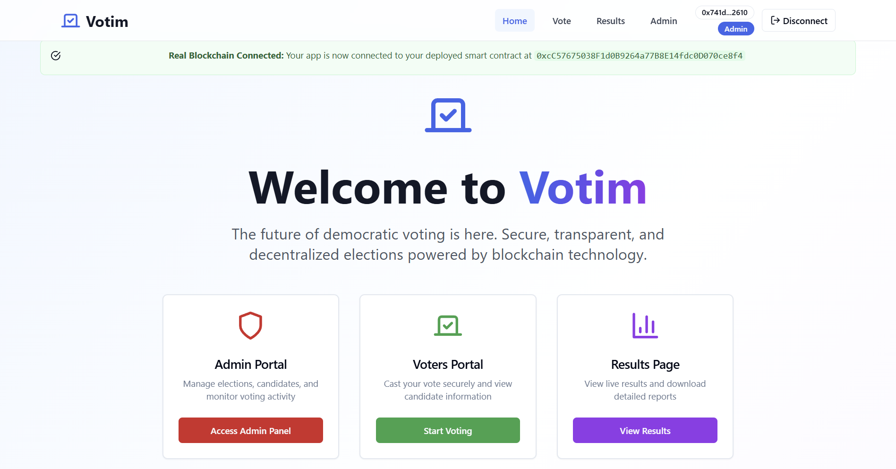
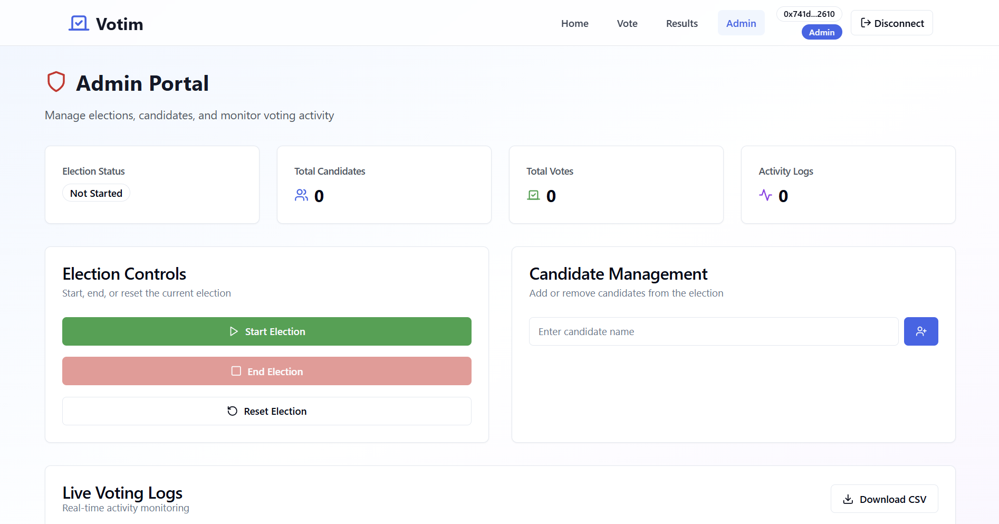
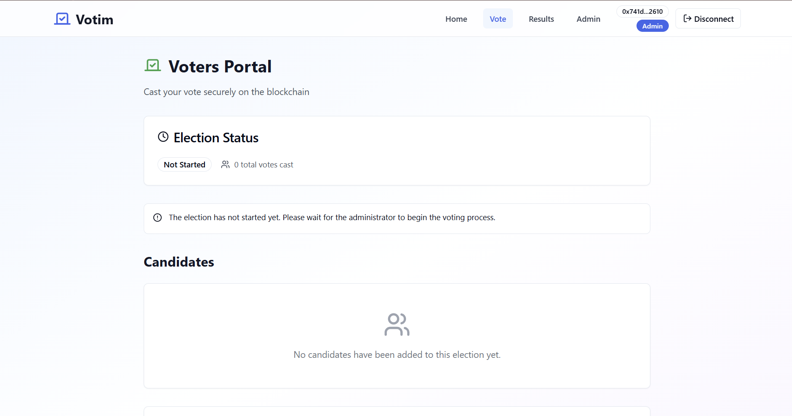
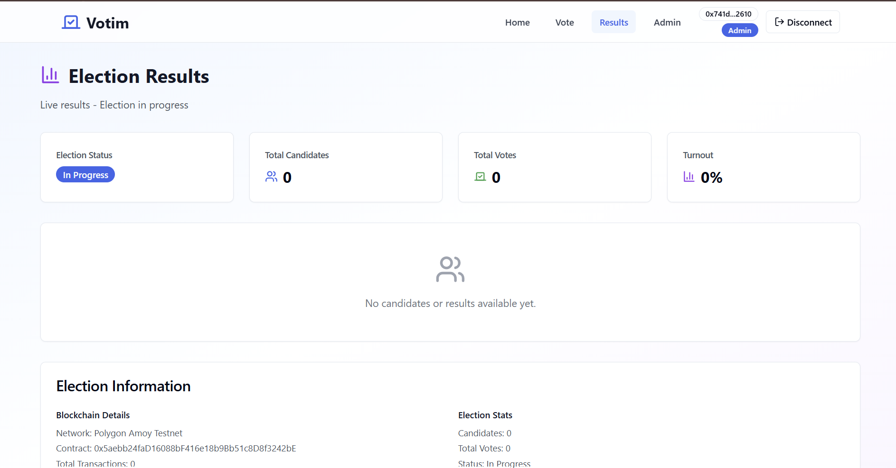

# VOTIM — Blockchain-Based Voting Platform

A responsive portfolio prototype for election administration, voter participation and result visualization.

> **Demo status:** This checkout contains a Next.js frontend with simulated election data. No Solidity contracts, ABI, Hardhat project, deployment scripts or contract address are present. Connecting a wallet does not make the demo votes blockchain transactions. Do not use this prototype for real elections.

## Overview and motivation

VOTIM explores separate administrator and voter workflows and the intended use of blockchain for reviewable election records. The supplied implementation demonstrates the presentation layer and wallet connectivity. Blockchain execution remains future work.

## Features

| Capability | Verified implementation |
| --- | --- |
| Home, Admin, Voter, Results | Implemented frontend routes |
| MetaMask/injected wallet | Account requests, Amoy selection, account/network/disconnect listeners |
| Candidate add/remove | In-memory demo operations |
| Election start/end/reset | In-memory demo operations |
| Voting / duplicate restriction | Local React state only; reload/navigation bypasses restriction |
| Results | Sample counts, bar/pie charts, table, winner display |
| Activity records | Seeded and generated demo records, not chain events |
| CSV export | Browser download with field escaping and formula neutralization |
| PDF export | Browser print dialog; choose Save as PDF |
| Voter registry / identity eligibility | Absent |
| Contract-based authorization and voting | Absent |

## Technology stack

Next.js 14 App Router, React 18, TypeScript, Tailwind CSS 3, Radix/shadcn UI, Lucide and Recharts. This is not a Vite application. Use npm and the complete `package-lock.json`; the original empty `pnpm-lock.yaml` is retained for provenance only.

## System architecture

```text
Browser -> Next.js routes -> useContract -> isolated React state (demo)
                         -> useWallet   -> window.ethereum -> wallet / Amoy
```

There is no backend, database, shared election store or contract client. Each `useContract` instance initializes sample candidates and counts. Changes do not synchronize between routes or persist. The Results screen does not reflect votes cast on another page.

## How blockchain voting would work

A future implementation would read a verified contract, submit wallet-signed transactions, await receipts and derive results/logs from contract storage and events. These voting transactions do not occur here. Demo election actions incur no gas costs.

## Smart contract functionality

No contract sources or tests are supplied. Administrative permissions, duplicate-vote prevention, voter eligibility, lifecycle transitions, candidate restrictions, vote counts, resets, event consistency and gas efficiency cannot be verified. No contract behavior was invented or changed.

## Administrative capabilities

The Admin screen compares the connected address with `NEXT_PUBLIC_ADMIN_ADDRESS`, falling back to the original demo address. This is a UI gate, not security enforcement. Candidate and lifecycle controls change only that screen's local state. Any user can modify client code.

## MetaMask integration

The app requests accounts explicitly through `window.ethereum`, requests Amoy, adds the network on an unknown-chain response, checks the selected chain and handles rejected requests. It listens for account/network/disconnect events. No recovery phrase or private key is required.

## Election workflow

1. Open `/` and choose a portal.
2. Optionally connect a wallet and approve Amoy selection.
3. `/admin`: use the configured demo admin account to explore local controls.
4. `/vote`: inspect sample candidates and cast a simulated vote.
5. `/results`: view sample charts and print/save the page as PDF.

Navigation resets election state. This demonstrates individual screens, not a shared end-to-end election.

## Polygon Amoy testnet

The wallet requests chain ID `80002` (`0x13882`), public RPC `https://rpc-amoy.polygon.technology/`, and explorer `https://amoy.polygonscan.com/`. RPC availability depends on the external provider. No deployed contract or verified testnet election exists in this checkout.

## Installation

Use Node.js 20 and npm 10. Validation used Node 20.19.4.

```bash
git clone https://github.com/xtej0/VOTIM---Blockchain-based-voting-machine.git
cd VOTIM---Blockchain-based-voting-machine
npm ci
cp .env.example .env.local
npm run dev
```

PowerShell: `Copy-Item .env.example .env.local`. Open [localhost:3000](http://localhost:3000).

## Environment configuration

| Variable | Purpose |
| --- | --- |
| `NEXT_PUBLIC_ADMIN_ADDRESS` | Optional public demo admin address; compiled into client code |

No contract address or secret is required. Never put a private key or seed phrase in client variables. `.env.local` is ignored. Restart/rebuild after changing public configuration.

## Running the frontend

```bash
npm run dev
npm run typecheck
npm test
npm run build
npm start
```

The original `npm run lint` requires an ESLint setup that was not supplied. It is not a validated gate. TypeScript build-error suppression has been removed.

## Compiling and testing contracts

Unavailable: this repository has no Solidity/Hardhat project. There are no valid contract compilation or test commands to provide. Frontend regression tests run with `npm test`.

## Local blockchain setup

Not required for the simulated frontend. Recover the original contract project and its toolchain/tests before adding local-node instructions.

## Optional testnet deployment

No deployment script exists. Future work requires reviewed contract sources, a pinned compiler/toolchain, tests, environment-based signer configuration and a verified ABI/address mapping. No deployment or gas-spending transaction was performed. Deployment needs separate authorization.

## Screenshots

Actual supplied project captures; they predate the demo notice and small audit copy corrections. Screenshots demonstrate UI appearance, not on-chain execution.






## Security considerations and limitations

- Prototype only; no independent audit, production readiness, anonymity or tamper-proof guarantee.
- Election state and restrictions are mutable, isolated client state.
- UI administrator checks do not enforce authorization.
- Logs are examples; generated vote references have an explicit `demo-` prefix.
- Public blockchain records do not automatically ensure ballot secrecy or identity verification.
- Contract reads/writes, transaction receipts and contract address validation are absent.
- PDF output uses the browser's print/Save as PDF support.
- See [audit findings and verification](docs/audit-report.md) for dependency advisories and remaining limits.

## Future improvements

Recover and review the original contract project; enforce authorization and eligibility on-chain; implement shared contract reads and receipt-driven writes; add contract/provider/integration tests and CI; define tie/no-vote outcomes; improve print styling and durable exports. These are planned capabilities.

## License

[MIT](LICENSE). The original GitHub commit and license are preserved.
